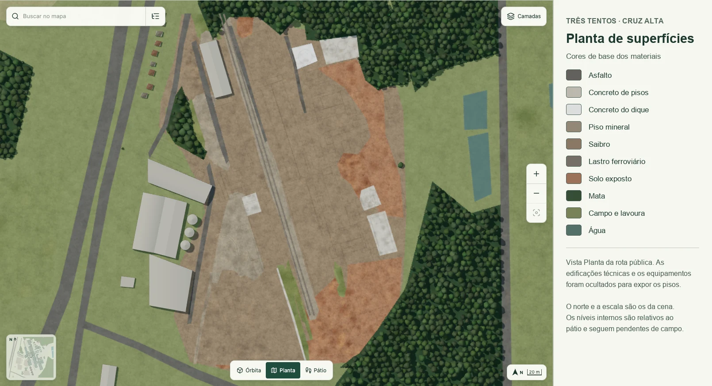

# Planta de superfícies e via permanente

A imagem registra o modo **Planta** da rota de Cruz Alta com edificações técnicas, equipamentos e paisagem regional ocultados. A implantação e os relevos aparecem na mesma escala métrica do passeio. As cores da legenda são os albedos sRGB antes da luz diurna.

| Trecho                                                              | Evidência consultada no acervo                                                                                                                                                       | Interpretação da revisão                                                                                                                                                                                                                                                                                       | Atributo pendente e verificação                                                                                                                                                                                                                |
| ------------------------------------------------------------------- | ------------------------------------------------------------------------------------------------------------------------------------------------------------------------------------ | -------------------------------------------------------------------------------------------------------------------------------------------------------------------------------------------------------------------------------------------------------------------------------------------------------------- | ---------------------------------------------------------------------------------------------------------------------------------------------------------------------------------------------------------------------------------------------- |
| Corredor ferroviário e circulação junto a 11/56, Casca e Armazém 02 | Fotografia da folha 1 do A1 rev. 56 girada para leitura dos eixos. DJI 0044 e quadro do vídeo a 150 s mostram a faixa longitudinal entre as naves e o pavimento adjacente.           | Faixa de serviço de piso mineral ligada aos dois eixos existentes. O aço tem patim, alma e boleto contínuos. Os centros dos trilhos têm afastamento visual de 1,26 m. O piso de manobra conserva Y = 0 e a altura visível do boleto é reduzida nesse trecho.                                                   | Confirmar bitola nominal, seção do perfil, término e eventual cruzamento no pátio. Obter planta cadastrada da via, seção da canaleta e medidas entre faces internas dos boletos.                                                               |
| Ombros de lastro nas extremidades da ferrovia                       | No A1 rev. 56 aparecem faixas mais estreitas nos eixos junto ao trecho aberto. O quadro a 150 s permite reconhecer a separação entre corredor e pátio.                               | Duas faixas com crista de +0,095 m nos segmentos externos e transição linear de 2,4 m nas pontas. A implantação usa larguras aparentes de 2,24 m na base e 1,74 m na crista. Dormentes interpretados com 1,96 m e passo de 0,67 m somente nos segmentos abertos. Aço, apoio e agregado conservam o mesmo eixo. | Confirmar quais segmentos têm dormentes expostos, material e espaçamento, largura do lastro e greide nos encontros. Uma foto baixa perpendicular à via em cada extremidade e perfis longitudinal e transversal da via resolvem a configuração. |
| Via de aproximação e pátios de manobra e balanças                   | A1 rev. 56, DJI 0044, registro das áreas de balança no levantamento e vista aérea do pátio dos silos. A fotografia mostra bordas de pavimento e duas marcas de giro no pátio aberto. | O limite entre via e pátio usa os mesmos vértices para a faixa de asfalto e a junta. Saibro domina o leito de manobra e o acabamento mineral é localizado nas circulações cinzentas. Os rastros de giro seguem os traçados da fotografia, com contraste moderado. Cota local de referência Y = 0.              | Confirmar se a faixa cinza é revestimento betuminoso, concreto ou agregado compactado. Projeto de pavimentação, foto de chão com escala, posição de juntas e nivelamento transversal no encontro da aproximação com o pátio.                   |
| Reservatório norte · corpo 6                                        | A1 rev. 56 e vídeo a 150 s. O quadro mostra concreto claro e contenção em volta do reservatório.                                                                                     | Lábio contínuo de concreto, com cerca de 0,60 m aparentes e piso interno plano a +0,08 m. Os vértices da linha de quebra mantêm o terreno externo em Y = 0. A base do corpo, o passeio e o bloqueio da mureta usam as mesmas posições da malha.                                                                | Confirmar soleira, aberturas, seção da mureta e cotas interna e externa. Corte pelo eixo do tanque, fotos dos cantos do dique e nivelamento amarrado ao pátio.                                                                                 |
| Bases de equipamentos, caldeiras, silos e faixas junto às copas     | A1 rev. 56, panorâmica dos silos sul e quadros a 36, 72 e 150 s. Concreto aparece nas bases e faixas técnicas, com terra exposta entre as áreas construídas e os maciços vegetados.  | Polígonos separam concreto, piso mineral, saibro, solo exposto e mata. Onde as relações verticais são ilegíveis mantém-se Y = 0. As áreas de água e os polígonos de vegetação observados preservam o contorno da base.                                                                                         | Confirmar altura das plataformas e das rampas de encontro, perímetro das lajes e fundações. Levantamento por seções com cotas de apoios e terreno, complementado por fotos baixas da borda das bases e das transições para a mata.             |

## Apoio e acabamento na aproximação

A malha local e o apoio caminhável consultam a mesma triangulação. A paisagem regional começa na borda de cota zero do piso local, com transição de 225 m para o GLO-30. O datum regional permanece relativo à referência de 464,24 m. As árvores e as massas externas amostram os triângulos efetivamente desenhados quando a paisagem está ativa. A área caminhável continua na implantação. [Levantamento e registro geográfico](../levantamento.md) · [Licenças e créditos regionais](../horizonte.md)

A cor de setor usa a máscara panorâmica. A aproximação produz blocos de 512 × 512 no navegador, com bordas em metros e marcas de giro, transição e junta. A mesma distribuição métrica de tons aparece na órbita e nos blocos locais. Ela interpreta a aparência mais compactada, escura e fria das vias na DJI 0044, o agregado terroso dos corredores e a tonalidade do concreto e da terra exposta nos quadros a 0 e 150 s. A posição e o formato de cada mancha de desgaste são procedurais.

A borda ferroviária próxima é avaliada diretamente pela distância ao eixo, com antisserrilhamento nos ombros. Um mapa repetível de 256 × 256 separa quatro campos lineares. O asfalto usa agregado fino, o lastro usa partículas angulares de escala maior, o saibro usa finos compactados e o concreto usa poros localizados. A aplicação combina escalas em metros e modula a rugosidade por classe. O albedo usa sRGB. Os blocos são rasterizados gradualmente perto da câmera. O conjunto completo tem 9 MiB nominais em RGBA antes dos mipmaps e acrescenta 0 bytes de transferência de texturas externas. A luz direcional e a oclusão de contato de baixo contraste dividem a leitura da sombra.

Os desenhos métricos, os padrões procedurais e a planta acima foram gerados para o Nexus. Têm como origem as interpretações da tabela e seguem os termos de distribuição do código do projeto, sem atribuição de licença pública adicional. Os originais fotográficos e as pranchas permanecem no acervo privado. [Acervo de Cruz Alta](https://drive.google.com/drive/folders/1wexshbdZctbJ5zoLcwmIUh4-xx9kYxf4)
